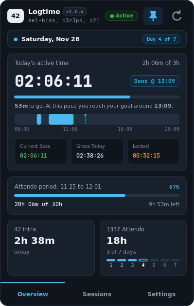
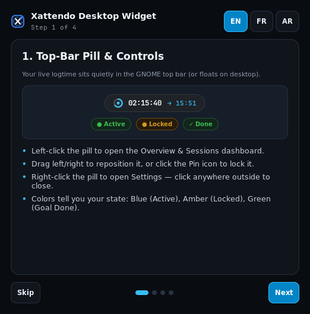

# Xattendo Desktop Widget

A 100% standalone, always-on-top desktop & GNOME Top Bar widget for **42 Logtime** and **1337 Attendo** — built to live right in your top bar with zero local web servers and zero GNOME Shell extensions.

## Why I Built This

This project was inspired by the [xattendo](https://github.com/mohamednasih/attendo) web app created by my friend **Mohamed Nasih**.

Most of my day is spent inside the terminal and VS Code, so opening a browser tab just to check my logtime, daily goal, or Attendo hours created constant context-switching cost. I wanted something close, instant, and distraction-free — always visible in the GNOME top bar and one click away.

---

## Screenshots

<p align="center">
  
</p>

<p align="center">
  
  &nbsp;&nbsp;
  
</p>

---

## Install

### Quick Install (Recommended)

```bash
curl -fsSL https://raw.githubusercontent.com/ael-biss/xattendo-widget/main/install.sh | bash
```

Downloads the latest `xattendo-widget.pyz` release to `~/.local/bin/xattendo-widget`, enables login autostart in `~/.config/autostart/xattendo-desktop-widget.desktop`, and starts the widget immediately.

### Install From Source

```bash
git clone https://github.com/ael-biss/xattendo-widget.git
cd xattendo-widget
make install
```

### Uninstall

```bash
make uninstall
```

---

## How to Use

### 1. Top-Bar Pill & Controls
- **Left-click** the pill to open the **Overview / Sessions** popup.
- **Drag** left/right in the top bar (or anywhere in floating mode) to reposition it, and click the **Pin** icon in the popup header to lock its position.
- **Right-click** the pill to open **Settings** — click anywhere outside Settings or Popup to dismiss it.
- **Pill colors**:
  - **Blue**: Active session, tracking normally (`02:06:11 → 15:51`).
  - **Amber**: Workstation locked (`Locked | 02:06:11`).
  - **Green**: Daily goal reached (`Done | 05:10:00 ✓ 15:51`).
  - **Update badge (`↑ vX.Y.Z`)**: A new release is ready to install.

### 2. Current Day & Daily Goal Finish Time (`→ 12:45`)
- **Today Strip**: Prominently shows the current weekday, date, and your exact period day (`Saturday, Nov 28 · Day 4 of 7`).
- **Numbered 7-Day Bar (`1–7`)**: Highlights the exact day you are currently in so you always know where you stand in your personal 7-day Attendo period.
- **Finish ETA**: Displays the exact clock time you will hit today's goal right on the top-bar pill (`→ 15:51`), on the Home badge (`Done @ 15:51`), and as a dashed emerald marker on your daily timeline.

### 3. Link 42 Intra & 1337 Attendo (Any Browser)
- **Automatic Cookie Sync**: Reads signed-in sessions from **Brave**, **Firefox**, **Chrome**, **Chromium**, **Vivaldi**, **Opera**, **Edge**, **Zen Browser**, **LibreWolf**, **Floorp**, and **Waterfox** (pure-Python decryption, zero `pip` dependencies).
- **Universal 1-Click Sign-In**: Using another browser or want instant linking? Click **Sign in (Attendo & 42 Intra)** in Settings (or `Link ↗` on the cards) to sign in once inside the built-in window and sync both accounts automatically.

### 4. First-Time Quick Guide & Automatic Updates
- **Quick Guide**: Launches automatically on your first run to walk you through each feature in 4 simple steps, and can be reopened anytime from **Settings → Quick Guide**.
- **In-Home Updates**: Automatically checks for new releases at startup and every 30 minutes, prompting right inside the widget Home card for a 1-click update and restart.
- **Multilingual UI**: Supports **English**, **Français**, and **العربية** (full RTL layout).

---

## Developer Commands

```bash
make test          # Run automated unit tests
make build         # Build bytecode-only dist/xattendo-widget.pyz (0 .py source files)
make install       # Build & install locally to ~/.local/bin/xattendo-widget + autostart
make uninstall     # Remove installed app, extracted assets, and autostart
make run           # Run directly from source
make stop          # Stop running widget
make sim-active    # Simulate active session + linked Intra & Attendo
make sim-locked    # Simulate locked workstation (amber)
make sim-done      # Simulate period target reached (green)
make sim-unlinked  # Simulate local session with unlinked Intra & Attendo
make sim-update    # Simulate forced in-home update screen
```


## Issues & Feedback

Found a bug or have a feature idea? Please open an issue on GitHub:
https://github.com/ael-biss/xattendo-widget/issues

## Credits

- Inspired by [xattendo](https://github.com/mohamednasih/attendo) by **Mohamed Nasih**.
